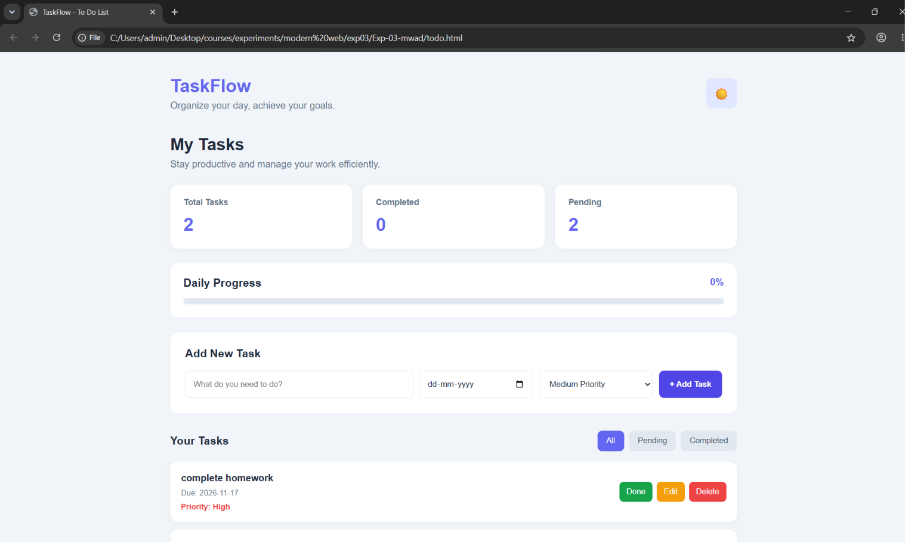

# Ex03 To-Do List using JavaScript
## Date:17-11-2026

## AIM
To create a To-do Application with all features using JavaScript.

## ALGORITHM
### STEP 1
Build the HTML structure (index.html).

### STEP 2
Style the App (style.css).

### STEP 3
Plan the features the To-Do App should have.

### STEP 4
Create a To-do application using Javascript.

### STEP 5
Add functionalities.

### STEP 6
Test the App.

### STEP 7
Open the HTML file in a browser to check layout and functionality.

### STEP 8
Fix styling issues and refine content placement.

### STEP 9
Deploy the website.

### STEP 10
Upload to GitHub Pages for free hosting.

## PROGRAM
todo.html
```

<!DOCTYPE html>
<html lang="en">
<head>
    <meta charset="UTF-8">
    <meta name="viewport" content="width=device-width, initial-scale=1.0">
    <title>TaskFlow - To Do List</title>
    <link rel="stylesheet" href="style.css">
</head>
<body>

<div class="container">

    <header>
        <div>
            <h1>TaskFlow</h1>
            <p>Organize your day, achieve your goals.</p>
        </div>
        <button id="themeBtn">☀️</button>
    </header>

    <div class="welcome">
        <h2>My Tasks</h2>
        <p>Stay productive and manage your work efficiently.</p>
    </div>

    <div class="stats">

        <div class="stat-card">
            <h3>Total Tasks</h3>
            <h2 id="totalTasks">0</h2>
        </div>

        <div class="stat-card">
            <h3>Completed</h3>
            <h2 id="completedTasks">0</h2>
        </div>

        <div class="stat-card">
            <h3>Pending</h3>
            <h2 id="pendingTasks">0</h2>
        </div>

    </div>

    <div class="progress-box">
        <div class="progress-heading">
            <h3>Daily Progress</h3>
            <span id="progressText">0%</span>
        </div>

        <div class="progress-bar">
            <div id="progressFill"></div>
        </div>
    </div>

    <div class="task-form">

        <h3>Add New Task</h3>

        <div class="input-section">

            <input
                type="text"
                id="taskInput"
                placeholder="What do you need to do?"
            >

            <input type="date" id="dueDate">

            <select id="priority">
                <option value="High">High Priority</option>
                <option value="Medium" selected>Medium Priority</option>
                <option value="Low">Low Priority</option>
            </select>

            <button id="addBtn">+ Add Task</button>

        </div>

    </div>

    <div class="task-heading">

        <h3>Your Tasks</h3>

        <div class="filter-section">

            <button class="filter-btn active"
                    data-filter="all">All</button>

            <button class="filter-btn"
                    data-filter="pending">Pending</button>

            <button class="filter-btn"
                    data-filter="completed">Completed</button>

        </div>

    </div>

    <ul id="taskList"></ul>

    <p id="emptyMessage">No tasks found. Add a new task!</p>

</div>

<script src="script.js"></script>

</body>
</html>

```

style.css

```

* {
    margin: 0;
    padding: 0;
    box-sizing: border-box;
    font-family: Arial, sans-serif;
}

body {
    background: #f1f5f9;
    color: #1e293b;
    min-height: 100vh;
    padding: 40px 20px;
    transition: 0.3s;
}

.container {
    max-width: 950px;
    margin: auto;
}

header {
    display: flex;
    justify-content: space-between;
    align-items: center;
    margin-bottom: 40px;
}

header h1 {
    color: #6366f1;
    font-size: 30px;
}

header p {
    color: #64748b;
    margin-top: 6px;
}

#themeBtn {
    border: none;
    background: #e0e7ff;
    padding: 12px;
    border-radius: 10px;
    cursor: pointer;
    font-size: 20px;
}

.welcome {
    margin-bottom: 25px;
}

.welcome h2 {
    font-size: 28px;
    margin-bottom: 8px;
}

.welcome p {
    color: #64748b;
}

.stats {
    display: grid;
    grid-template-columns: repeat(3, 1fr);
    gap: 18px;
    margin-bottom: 25px;
}

.stat-card {
    background: white;
    padding: 22px;
    border-radius: 14px;
    box-shadow: 0 3px 12px #00000008;
}

.stat-card h3 {
    color: #64748b;
    font-size: 14px;
}

.stat-card h2 {
    margin-top: 12px;
    font-size: 30px;
    color: #6366f1;
}

.progress-box {
    background: white;
    padding: 22px;
    border-radius: 14px;
    margin-bottom: 25px;
}

.progress-heading {
    display: flex;
    justify-content: space-between;
    margin-bottom: 15px;
}

.progress-heading span {
    color: #6366f1;
    font-weight: bold;
}

.progress-bar {
    background: #e2e8f0;
    height: 10px;
    border-radius: 20px;
    overflow: hidden;
}

#progressFill {
    background: #6366f1;
    height: 100%;
    width: 0%;
    border-radius: 20px;
    transition: 0.3s;
}

.task-form {
    background: white;
    padding: 25px;
    border-radius: 14px;
    margin-bottom: 30px;
}

.task-form h3 {
    margin-bottom: 18px;
}

.input-section {
    display: grid;
    grid-template-columns: 2fr 1fr 1fr auto;
    gap: 10px;
}

input, select {
    width: 100%;
    padding: 13px;
    border: 1px solid #e2e8f0;
    border-radius: 8px;
    outline: none;
    background: white;
    color: #1e293b;
}

input:focus, select:focus {
    border-color: #6366f1;
}

#addBtn {
    border: none;
    background: #6366f1;
    color: white;
    padding: 12px 18px;
    border-radius: 8px;
    cursor: pointer;
    font-weight: bold;
}

#addBtn:hover {
    background: #4f46e5;
}

.task-heading {
    display: flex;
    justify-content: space-between;
    align-items: center;
    margin-bottom: 18px;
    gap: 12px;
    flex-wrap: wrap;
}

.filter-section {
    display: flex;
    gap: 8px;
}

.filter-btn {
    border: none;
    padding: 9px 15px;
    border-radius: 8px;
    background: #e2e8f0;
    cursor: pointer;
    color: #475569;
}

.filter-btn.active {
    background: #6366f1;
    color: white;
}

ul {
    list-style: none;
}

li {
    background: white;
    padding: 18px;
    border-radius: 12px;
    margin-bottom: 13px;
    display: flex;
    justify-content: space-between;
    align-items: center;
    gap: 15px;
    box-shadow: 0 3px 12px #00000008;
}

.task-info {
    flex: 1;
    overflow-wrap: anywhere;
}

.task-info strong {
    font-size: 16px;
}

.task-date {
    margin-top: 8px;
    font-size: 13px;
    color: #64748b;
}

.priority {
    margin-top: 8px;
    font-size: 13px;
    font-weight: bold;
}

.high {
    color: #ef4444;
}

.medium {
    color: #f59e0b;
}

.low {
    color: #16a34a;
}

.completed {
    text-decoration: line-through;
    opacity: 0.5;
}

.task-buttons {
    display: flex;
    gap: 7px;
}

.task-buttons button {
    border: none;
    padding: 9px 12px;
    border-radius: 7px;
    cursor: pointer;
    color: white;
}

.complete-btn {
    background: #16a34a;
}

.edit-btn {
    background: #f59e0b;
}

.delete-btn {
    background: #ef4444;
}

#emptyMessage {
    text-align: center;
    color: #94a3b8;
    padding: 30px;
    display: none;
}

/* Dark Mode */

body.dark {
    background: #0f172a;
    color: white;
}

.dark .stat-card,
.dark .progress-box,
.dark .task-form,
.dark li {
    background: #1e293b;
    color: white;
}

.dark header p,
.dark .welcome p,
.dark .task-date {
    color: #94a3b8;
}

.dark input,
.dark select {
    background: #334155;
    color: white;
    border-color: #475569;
}

.dark .filter-btn {
    background: #334155;
    color: white;
}

.dark .filter-btn.active {
    background: #6366f1;
}

.dark .progress-bar {
    background: #334155;
}

.dark #themeBtn {
    background: #334155;
}

/* Responsive Design */

@media(max-width: 750px) {

    .input-section {
        grid-template-columns: 1fr 1fr;
    }

    #addBtn {
        grid-column: span 2;
    }

    .stats {
        grid-template-columns: 1fr;
    }
}

@media(max-width: 500px) {

    body {
        padding: 20px 12px;
    }

    .input-section {
        grid-template-columns: 1fr;
    }

    #addBtn {
        grid-column: span 1;
    }

    li {
        flex-direction: column;
        align-items: flex-start;
    }

    .task-buttons {
        width: 100%;
    }

    .task-buttons button {
        flex: 1;
    }
}

```

script.js

```

const addBtn = document.getElementById("addBtn");
const taskInput = document.getElementById("taskInput");
const taskList = document.getElementById("taskList");

const dueDate = document.getElementById("dueDate");
const priority = document.getElementById("priority");

const themeBtn = document.getElementById("themeBtn");

const filterButtons = document.querySelectorAll(".filter-btn");

let tasks = [];
let currentFilter = "all";

// SAVE TASKS

function saveTasks() {
    localStorage.setItem("tasks", JSON.stringify(tasks));
}

// LOAD TASKS

function loadTasks() {

    const storedTasks = localStorage.getItem("tasks");

    if (storedTasks) {
        tasks = JSON.parse(storedTasks);
    }

    displayTasks();
    updateStats();
}

// UPDATE DASHBOARD

function updateStats() {

    const total = tasks.length;

    const completed = tasks.filter(
        task => task.completed
    ).length;

    const pending = total - completed;

    const percentage = total === 0
        ? 0
        : Math.round((completed / total) * 100);

    document.getElementById("totalTasks").innerText = total;

    document.getElementById("completedTasks").innerText = completed;

    document.getElementById("pendingTasks").innerText = pending;

    document.getElementById("progressText").innerText =
        percentage + "%";

    document.getElementById("progressFill").style.width =
        percentage + "%";
}

// DISPLAY TASKS

function displayTasks() {

    taskList.innerHTML = "";

    let visibleTasks = 0;

    tasks.forEach((task, index) => {

        if (currentFilter === "completed" && !task.completed) {
            return;
        }

        if (currentFilter === "pending" && task.completed) {
            return;
        }

        visibleTasks++;

        const li = document.createElement("li");

        const taskInfo = document.createElement("div");
        taskInfo.classList.add("task-info");

        if (task.completed) {
            taskInfo.classList.add("completed");
        }

        let priorityClass = task.priority.toLowerCase();

        const taskName = document.createElement("strong");
        taskName.textContent = task.text;

        const date = document.createElement("div");
        date.classList.add("task-date");
        date.textContent = "Due: " + (task.date || "No Date");

        const priorityText = document.createElement("div");
        priorityText.classList.add("priority", priorityClass);
        priorityText.textContent = "Priority: " + task.priority;

        taskInfo.appendChild(taskName);
        taskInfo.appendChild(date);
        taskInfo.appendChild(priorityText);

        const buttonDiv = document.createElement("div");
        buttonDiv.classList.add("task-buttons");

        // COMPLETE BUTTON

        const doneBtn = document.createElement("button");
        doneBtn.innerText = task.completed ? "Undo" : "Done";
        doneBtn.classList.add("complete-btn");

        doneBtn.addEventListener("click", function() {

            tasks[index].completed = !tasks[index].completed;

            saveTasks();
            displayTasks();
            updateStats();
        });

        // EDIT BUTTON

        const editBtn = document.createElement("button");
        editBtn.innerText = "Edit";
        editBtn.classList.add("edit-btn");

        editBtn.addEventListener("click", function() {

            const updatedTask = prompt("Edit Task", task.text);

            if (updatedTask !== null && updatedTask.trim() !== "") {

                tasks[index].text = updatedTask.trim();

                saveTasks();
                displayTasks();
            }
        });

        // DELETE BUTTON

        const deleteBtn = document.createElement("button");
        deleteBtn.innerText = "Delete";
        deleteBtn.classList.add("delete-btn");

        deleteBtn.addEventListener("click", function() {

            if (confirm("Are you sure you want to delete this task?")) {

                tasks.splice(index, 1);

                saveTasks();
                displayTasks();
                updateStats();
            }
        });

        buttonDiv.appendChild(doneBtn);
        buttonDiv.appendChild(editBtn);
        buttonDiv.appendChild(deleteBtn);

        li.appendChild(taskInfo);
        li.appendChild(buttonDiv);

        taskList.appendChild(li);

    });

    document.getElementById("emptyMessage").style.display =
        visibleTasks === 0 ? "block" : "none";
}

// ADD TASK

addBtn.addEventListener("click", function() {

    const text = taskInput.value.trim();

    if (text === "") {
        alert("Please enter a task");
        return;
    }

    const task = {

        text: text,
        date: dueDate.value,
        priority: priority.value,
        completed: false
    };

    tasks.push(task);

    saveTasks();

    taskInput.value = "";
    dueDate.value = "";

    displayTasks();
    updateStats();
});

// FILTER TASKS

filterButtons.forEach(function(button) {

    button.addEventListener("click", function() {

        currentFilter = button.dataset.filter;

        filterButtons.forEach(btn =>
            btn.classList.remove("active")
        );

        button.classList.add("active");

        displayTasks();
    });
});

// DARK / LIGHT MODE

themeBtn.addEventListener("click", function() {

    document.body.classList.toggle("dark");

    if (document.body.classList.contains("dark")) {
        themeBtn.innerText = "☀️";
    } else {
        themeBtn.innerText = "🌙";
    }

});

// LOAD TASKS

loadTasks();

```

## OUTPUT



## RESULT
The program for creating To-do list using JavaScript is executed successfully.